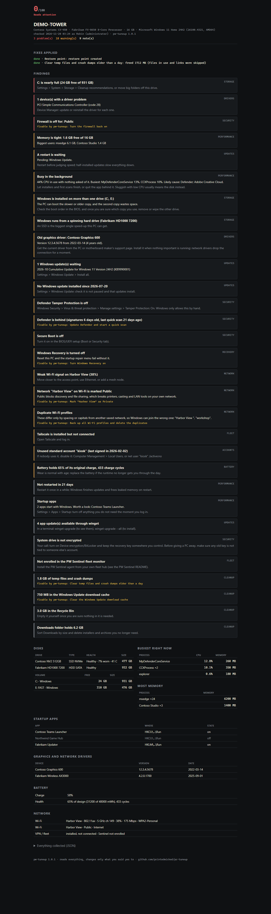

# pw-tuneup

One Windows exe that checks everything that usually makes a PC slow or unsafe, writes a report, and fixes **only
what you say yes to**. x64 and ARM64, no install, no dependencies beyond Windows PowerShell 5.1 (built into Windows).

## Quickstart

Build it (needs [Go](https://go.dev/dl/) 1.24 or newer; no cgo):

```sh
git clone https://github.com/printedwicked/pc-tuneup
cd pc-tuneup
go test ./...                 # the rules, against the made-up PC
./build.sh                    # Git Bash / Linux / macOS: dist/win/amd64 and dist/win/arm64
```

or on Windows PowerShell:

```powershell
$env:GOOS='windows'; $env:GOARCH='amd64'
go build -trimpath -ldflags "-s -w" -o dist\win\amd64\pw-tuneup.exe ./cmd/pw-tuneup
```

Then on the Windows PC, double-click `pw-tuneup.exe`. It asks for administrator rights (say Yes for the full check),
checks the PC (30–90 seconds, read-only), lists what it found, offers the fixes it can do, and opens the report.
Reports land in `Documents\PW Tune-up\<PC>-<YYYYMMDD-HHMM>\` (or `--out DIR`) (`report.html` + `report.json`).

```
pw-tuneup                 check, offer fixes, open the report
pw-tuneup --report-only   check and report, change nothing
pw-tuneup --dry-run       walk through the fixes and say what each would do, change nothing
pw-tuneup --yes           apply every safe fix without asking (network changes are still asked)
pw-tuneup --deep          also offer DISM component cleanup (several minutes)
pw-tuneup --json          findings + raw data as JSON on stdout, change nothing
pw-tuneup --no-admin      skip the UAC prompt
pw-tuneup --no-restore-point  apply the chosen fixes even if no restore point could be made (otherwise it asks)
pw-tuneup --out DIR       write the report there
pw-tuneup --no-open       don't open the report
pw-tuneup --version       print the version
```

## What it checks

| Area | Checks |
|---|---|
| Performance | free RAM and the biggest users, background CPU with known culprits named (Adobe CC, Defender scanning another app's writes, Windows Update, indexing, OneDrive), uptime, power plan, startup apps |
| Storage | free space per drive, disk health / wear / temperature / read errors, Windows on a spinning disk, **Windows installed on two drives** |
| Drivers | graphics and network driver age (> 2 years), devices with driver errors |
| Updates | pending restart, waiting Windows updates (Defender signature updates not counted), last install date, winget app updates |
| Security | real-time AV, Tamper Protection, signature and scan age, firewall per profile, Secure Boot, TPM, BitLocker |
| Recovery | Windows RE enabled ("Reset this PC" fails without it) |
| Network | Wi-Fi signal / band / radio, networks marked **Public**, **duplicate Wi-Fi profiles** (e.g. an SSID saved twice, once with a trailing space) |
| Accounts | enabled local accounts unused for 90+ days |
| Battery | laptops: battery wear from `powercfg /batteryreport` |
| Fleet | Tailscale installed (note) and connected (warning), the [PW Sentinel](https://github.com/printedwicked) agent enrolled (note) |
| Cleanup | temp files, crash dumps, Windows Update download cache, Recycle Bin size |

Limitation: the Wi-Fi and Windows RE checks parse the English output of `netsh wlan` and `reagentc /info`, so on a
Windows set to another display language those two checks can come up empty.

## What it fixes (only with a yes; a restore point is made first)

Before the first fix it makes a System Restore point (Windows allows one a day, so one from the last 24 hours
counts). If that fails, or cannot be tried because it runs without administrator rights, it stops and asks whether
to go on without one (default no); with nobody at the console to ask it applies nothing unless `--no-restore-point`
was given.

`temp` clear temp files and crash dumps older than a day (file by file; junctions and links are never followed or
deleted) · `wucache` clear the Windows Update download cache · `components` DISM component cleanup (`--deep`) ·
`netprivate` mark a network Private (asks "is this your own network?" every time; the profile is matched by its
exact name) · `winre` turn Windows Recovery on · `wifidupes` back up all Wi-Fi profiles (keys stay encrypted to
the PC) and delete the duplicates by exact name (WlanDeleteProfile; names it cannot match safely are refused),
keeping the connected one; the result lists the `netsh wlan add profile filename="..."` that puts each back ·
`defender` update signatures and start a quick scan · `firewall` turn the firewall back on.

It never touches drivers, BitLocker, accounts, Tamper Protection, startup apps or the Recycle Bin: those are reported
with what to do by hand.

## How it works

```
cmd/pw-tuneup/main.go       flags, UAC, the prompts, the fix loop
cmd/pw-tuneup/collect.ps1   read-only collector (embedded in the exe), prints one JSON object
cmd/pw-tuneup/fix.ps1       one named fix per run (embedded), prints {"ok","msg"}
cmd/pw-tuneup/findings.go   the rules: raw data -> findings and a score (pure Go, unit-tested)
cmd/pw-tuneup/report.*      the HTML report
cmd/pw-tuneup/testdata/     the made-up messy PC
```

The split keeps the dangerous part small: everything that reads the PC is one PowerShell script that changes nothing;
every change is a separate, named fix that runs only after you say yes, after a restore point. The scripts never
touch the disk: the exe hands each one to Windows PowerShell on stdin through a short `-EncodedCommand` bootstrap,
so there is no copy in a temp folder that another user could swap before the elevated run reads it.

## Screenshots



The report for the invented PC the tests use (`cmd/pw-tuneup/testdata/messy-pc.json`): every part, network and
account in it is made up. To render it yourself: `PW_TUNEUP_MOCK=<folder> go test -run TestRenderMock ./...`
writes `<folder>/report.html`; the screenshot is a headless Chrome `--screenshot` of it at 1280x4300.

## Licence

GNU Affero General Public License v3.0 — see [LICENSE](LICENSE).
Copyright © 2026 Printed Wicked.
